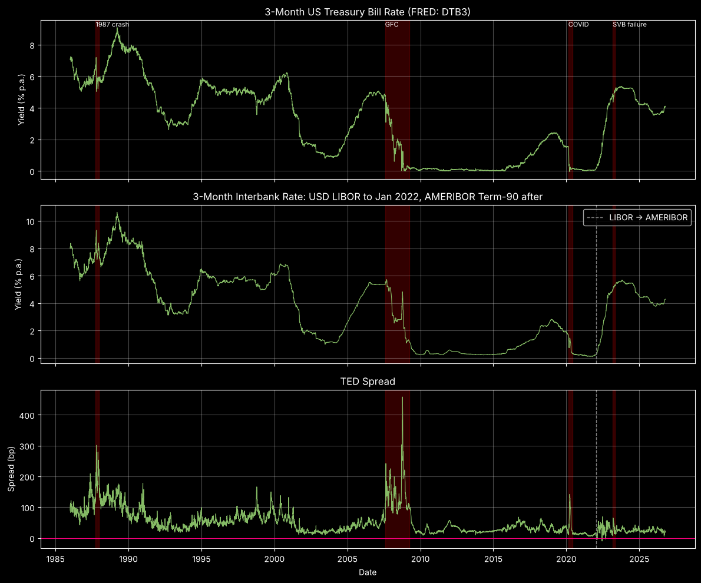
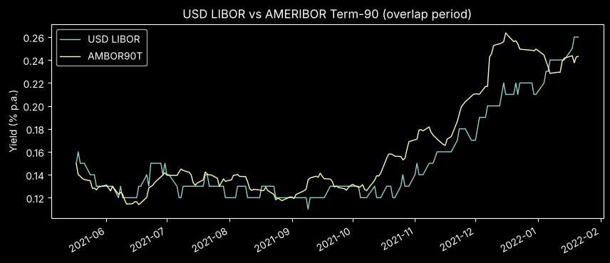

# The TED Spread After LIBOR

**Rebuilding a banking-stress indicator, 1986–2026 — and testing whether AMERIBOR can replace LIBOR.**

## Question

The TED spread (3-month interbank rate − 3-month T-bill) measures what banks pay over the US government to borrow unsecured. It widens when markets doubt bank solvency or rush into safe assets. Its interbank leg, 3-month USD LIBOR, is no longer published — so can the spread still be built, and does the substitute still detect stress?

## Key findings

- **Peak of 458 bp on 2008-10-10**, in the weeks after Lehman Brothers' collapse.
- **Flight to quality dominates.** In all four stress episodes the T-bill leg moved more than the interbank leg; during the GFC and COVID both legs fell, as Fed cuts pulled rates down while T-bills fell much further.
- **AMERIBOR works as a substitute — with a lag.** It matches reconstructed LIBOR on the overlap period and still flagged the SVB failure, but reacted several days after T-bills.

## Method

1. **Government leg:** 3-month T-bill, daily (FRED `DTB3`).
2. **Interbank leg to 2022-01-21:** 3-month USD LIBOR reconstructed as `TEDRATE + DTB3` (FRED stopped publishing LIBOR in Jan 2022).
3. **Interbank leg from 2022-01-24:** AMERIBOR Term-90 — unsecured, 3-month, based on US banks' actual funding costs. SOFR was rejected because it is secured and overnight, so carries no bank credit risk.
4. **Alignment:** both legs joined on common trading days (10,035 observations); spread in bp.

## Validating the splice

| Overlap 2021-05-17 → 2022-01-21 | |
|---|---|
| Trading days | 168 |
| Correlation | 0.921 |
| Mean gap (LIBOR − AMERIBOR) | −1.0 bp |
| Mean absolute gap | 1.5 bp |
| Largest gap | 5.4 bp |

The overlap is a calm, near-zero-rate period, so it validates the substitute's **level**, not its behaviour under stress — the SVB episode is the stress test.

## Stress episodes

Change from window start to the TED peak:

| Episode | Window → peak | Interbank | T-bill | TED |
|---|---|---|---|---|
| 1987 crash | 1987-10-01 → 1987-10-20 | +62 bp | −77 bp | **+139 bp** |
| Global Financial Crisis | 2007-08-01 → 2008-10-10 | −54 bp | −451 bp | **+397 bp** |
| COVID-19 | 2020-02-20 → 2020-03-26 | −31 bp | −160 bp | **+129 bp** |
| SVB failure | 2023-03-08 → 2023-03-17 | +5 bp | −53 bp | **+58 bp** |

Full economic reading of each episode is in the notebook.

## Limitations

- **AMERIBOR lags.** It is calculated over a window of recent transactions, so it trails fast moves: the spread went slightly negative on 5 days during the 2022 hiking cycle (low −10.1 bp), and the interbank leg moved days after T-bills during SVB.
- **Two instruments, one series.** The splice joins LIBOR (panel-submitted) and AMERIBOR (transaction-based); levels match on the overlap, but the series are not identical by construction.
- **Day-count conventions differ.** DTB3 is on a discount basis, LIBOR and AMERIBOR are money-market yields; this follows FRED's own TEDRATE convention and is not adjusted.

## Reproducing

Download the three series into `data/` (see [`data/README.md`](data/README.md)), then run `ted_spread.ipynb` top to bottom.
